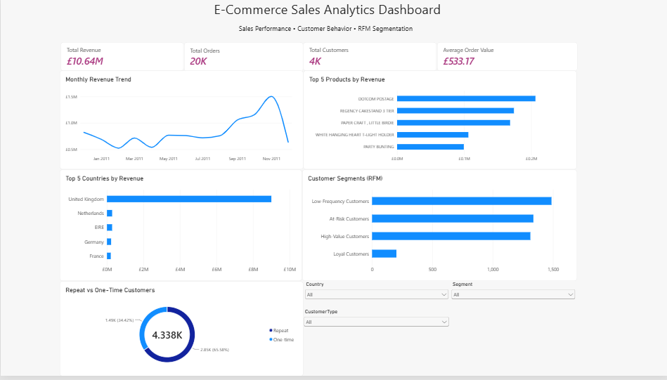

# E-Commerce Sales & Customer Analytics

## Project Overview

This project presents an end-to-end analysis of the UCI Online Retail dataset, covering data cleaning, exploratory data analysis, customer segmentation, SQL business analysis, and interactive dashboard development.

The objective is to transform raw e-commerce transaction data into actionable business insights related to sales performance, product performance, geographic markets, and customer behavior.

The project follows a complete analytics workflow:

**Raw Data → Data Cleaning → Exploratory Analysis → SQL Analysis → RFM Customer Segmentation → Power BI Dashboard → Business Insights**

---

## Business Questions

The analysis focuses on the following business questions:

- How are revenue and order activity changing over time?
- Which products generate the most revenue?
- Which countries contribute the most revenue?
- How concentrated is revenue among products and customers?
- What proportion of identifiable customers are repeat purchasers?
- Which customer groups can be identified using RFM segmentation?
- Which customer segments may require retention or re-engagement strategies?

---

## Dataset

The project uses the **Online Retail dataset** from the UCI Machine Learning Repository.

The dataset contains transactional data for a UK-based online retailer and includes purchases made by customers across multiple countries.

Official dataset:

[UCI Online Retail Dataset](https://archive.ics.uci.edu/dataset/352/online+retail)

The source workbook should be stored as:

`data/Online Retail.xlsx`

Important fields include:

- `InvoiceNo` — unique invoice identifier
- `StockCode` — product identifier
- `Description` — product description
- `Quantity` — number of units purchased
- `InvoiceDate` — transaction date and time
- `UnitPrice` — price per unit
- `CustomerID` — customer identifier
- `Country` — customer's country

---

## Tools & Technologies

The project uses:

- **Python 3**
- **Pandas** — data manipulation and analysis
- **NumPy** — numerical operations
- **Matplotlib** — data visualization
- **OpenPyXL** — Excel file processing
- **SQL / SQLite** — business queries and analytical aggregation
- **Power BI** — interactive dashboard development
- **Jupyter Notebook** — analysis workflow and documentation

---

## Data Cleaning

The raw transaction data is cleaned and transformed before analysis.

The main cleaning steps include:

- Converting `InvoiceDate`, `Quantity`, `UnitPrice`, and `CustomerID` to appropriate analytical data types
- Identifying and removing exact duplicate records
- Labelling missing product descriptions as `Unknown product`
- Retaining transactions with missing `CustomerID` for transaction, product, and country analysis
- Excluding missing customer identifiers from customer-level analysis
- Identifying cancelled invoices beginning with `C`
- Excluding non-positive quantities and prices from the primary completed-sales dataset
- Creating a calculated `Revenue` field
- Creating additional time-related features:
  - `Year`
  - `Month`
  - `YearMonth`
  - `DayOfWeek`
  - `Hour`

The cleaned analytical dataset is stored in:

`data/cleaned_online_retail.csv`

---

## Exploratory Data Analysis

Python is used to investigate overall sales performance and customer behavior.

The analysis includes:

- Total revenue
- Total orders
- Total customers
- Average order value
- Monthly revenue trends
- Product performance
- Country performance
- Customer purchase behavior
- Repeat vs one-time customers
- Customer-level purchase metrics
- RFM customer segmentation

Generated visualizations are stored in the `images/` directory.

---

## SQL Analysis

SQL is used to answer business-oriented questions using the cleaned transaction data.

Python's built-in `sqlite3` module is used to create:

`data/ecommerce_analytics.sqlite`

The cleaned transaction dataset is loaded into the:

`analytical_sales`

table, while customer-level RFM information is loaded into:

`customer_metrics`

The SQL queries are stored in:

`sql/business_queries.sql`

The queries examine areas such as:

- Revenue trends
- Product performance
- Geographic performance
- Customer behavior
- Revenue concentration
- Repeat customers
- Customer segmentation

Query outputs are automatically exported to:

`sql/results/`

including:

`query_01.csv` through `query_11.csv`

A summary of the SQL query outputs is stored in:

`sql/results/query_summary.csv`

---

## RFM Customer Segmentation

RFM analysis is used to group customers according to purchasing behavior.

RFM considers:

- **Recency** — how recently a customer purchased
- **Frequency** — how often the customer purchased
- **Monetary Value** — how much revenue the customer generated

Customers are grouped into business-oriented segments including:

- **High-Value Customers**
- **Loyal Customers**
- **At-Risk Customers**
- **Low-Frequency Customers**

The resulting customer-level dataset is stored in:

`data/customer_rfm.csv`

This segmentation can support targeted retention, re-engagement, and customer relationship strategies.

---

## Power BI Dashboard

An interactive Power BI dashboard was developed to communicate the main sales and customer insights from the analysis.



The dashboard includes:

- **Total Revenue**
- **Total Orders**
- **Total Customers**
- **Average Order Value**
- **Monthly Revenue Trend**
- **Top 5 Products by Revenue**
- **Top 5 Countries by Revenue**
- **RFM Customer Segments**
- **Repeat vs One-Time Customers**
- Interactive filters for:
  - Country
  - Customer Segment
  - Customer Type

The complete interactive Power BI report is available at:

`dashboard/ecommerce_dashboard.pbix`

The dashboard uses:

`data/power_bi_sales.csv`

as its prepared analytical data source.

---

## Key Findings

The analysis produced several notable observations:

- Completed sales generated approximately **£10.64 million in total revenue**.
- The analyzed dataset contains approximately **20K completed orders**.
- Approximately **4K identifiable customers** are represented in the analysis.
- Average order value is approximately **£533.17**.
- Revenue generally strengthened toward the later months of 2011, with a noticeable peak near the end of the analyzed period.
- The **United Kingdom** contributes substantially more revenue than any other individual country in the dataset.
- Revenue is concentrated among a relatively small group of high-performing products.
- Repeat customers represent an important portion of the identifiable customer base.
- RFM analysis reveals distinct customer groups with different purchasing behaviors, including high-value, at-risk, loyal, and low-frequency customers.

---

## Business Recommendations

Based on the observed patterns in the analysis:

- Prioritize retention strategies for **High-Value Customers** and repeat purchasers because they represent important ongoing customer relationships.
- Develop targeted re-engagement campaigns for **At-Risk Customers** to encourage additional purchases.
- Monitor **Low-Frequency Customers** and identify opportunities to increase purchase frequency through targeted promotions.
- Use top-performing products to support inventory planning and merchandising decisions.
- Monitor product-level revenue concentration to reduce excessive dependence on a small number of products.
- Continue monitoring the **United Kingdom** as the dominant market while evaluating opportunities for growth in other countries.
- Use monthly revenue trends to support inventory, marketing, and promotional planning during periods of changing demand.
- Use the Power BI dashboard's interactive filters to monitor performance across customer segments, customer types, and geographic markets.

---

## Repository Structure

```text
Ecommerce-Analytics/
│
├── dashboard/
│   ├── ecommerce_dashboard.pbix
│   └── README.md
│
├── data/
│   ├── Online Retail.xlsx
│   ├── cleaned_online_retail.csv
│   ├── customer_rfm.csv
│   ├── ecommerce_analytics.sqlite
│   └── power_bi_sales.csv
│
├── images/
│   ├── dashboard.png
│   ├── monthly_revenue.png
│   ├── repeat_customer_revenue.png
│   ├── rfm_segment_revenue.png
│   ├── top_countries_revenue.png
│   └── top_products_revenue.png
│
├── notebooks/
│   └── ecommerce_analysis.ipynb
│
├── sql/
│   ├── business_queries.sql
│   └── results/
│       ├── query_01.csv
│       ├── ...
│       ├── query_11.csv
│       └── query_summary.csv
│
├── README.md
└── requirements.txt
```

---

## Running the Project

Install the required Python packages:

```bash
python -m pip install -r requirements.txt
```

Open the Jupyter Notebook:

```bash
jupyter notebook notebooks/ecommerce_analysis.ipynb
```

Run the notebook cells from top to bottom.

The notebook performs the cleaning and analysis and generates the analytical datasets, SQL database, SQL query outputs, and visualizations used throughout the project.

The Power BI dashboard can then be opened using:

`dashboard/ecommerce_dashboard.pbix`

---

## Project Deliverables

The project demonstrates an end-to-end data analytics workflow involving:

**Data Cleaning → Exploratory Data Analysis → SQL → Customer Segmentation → Data Visualization → Power BI → Business Recommendations**

It demonstrates practical experience using **Python, SQL, Power BI, data visualization, KPI development, RFM segmentation, and business-oriented analytical thinking**.